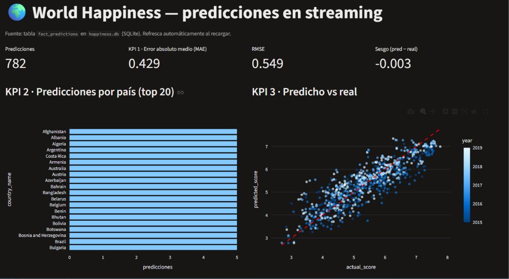
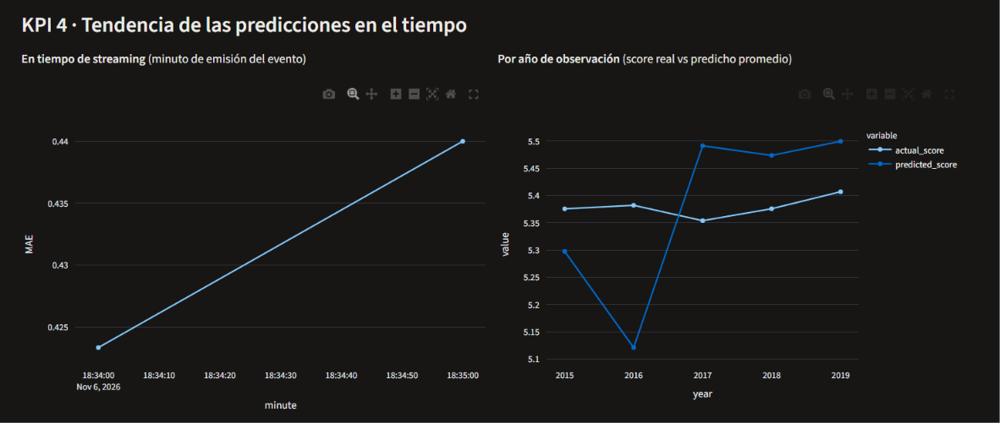
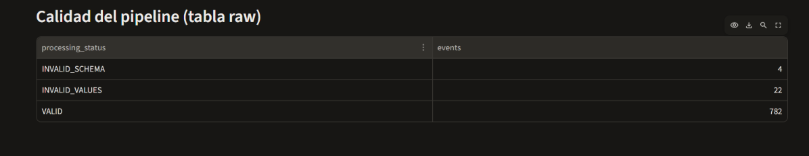

# Informe técnico — Workshop 3: Streaming ETL con Apache Kafka y Machine Learning

**Curso:** ETL (G01) · Ingeniería de Datos e IA · Universidad Autónoma de Occidente
**Dataset:** World Happiness Report 2015–2019 · **Stack:** Python 3.12, Apache Kafka 4.4 (Docker), scikit-learn, SQLite, Streamlit

---

## Tabla de contenido
1. Resumen ejecutivo
2. Arquitectura
3. Parte A — Integración, limpieza y modelo
4. Parte B — Pipeline Kafka y contrato del evento
5. Parte C — Base de datos y dashboard
6. Reproducción paso a paso
7. Verificación y pruebas realizadas
8. Cumplimiento del enunciado (checklist)
9. Limitaciones y trabajo futuro
10. Estructura del repositorio

---

## 1. Resumen ejecutivo
Se construyó un pipeline de punta a punta que (a) integra cinco CSV con esquemas distintos en un dataset único de **782 observaciones país-año (164 países)**, (b) entrena y serializa un pipeline de regresión (`model.pkl`), (c) emite cada observación como evento a Kafka, (d) consume los eventos validando un contrato, generando una predicción en tiempo real y guardando tanto el evento crudo como el resultado en una base de datos, y (e) muestra 4 KPIs en un dashboard que consulta la base de datos (no los CSV).

Resultado del modelo (test, países no vistos): **MAE 0.432 · RMSE 0.562 · R² 0.784** con regresión lineal. Como pide el enunciado, el foco está en la arquitectura, la confiabilidad y la reproducibilidad, no en maximizar la precisión.

## 2. Arquitectura
```
OFFLINE
 CSV 2015–2019 ─▶ EDA + limpieza + armonización ─▶ features ─▶ regresión ─▶ models/model.pkl
                    (notebooks/eda.ipynb)         (notebooks/model_training.ipynb)

STREAMING
 data/streaming/happiness_stream.csv
        │ fila por fila, delay configurable
        ▼
 Producer (key = country) ─▶ Topic happiness-events (3 particiones, RF=1) ─▶ Consumer (grupo happiness-ml-team)
                                                                                │
   1. INSERT en raw_happiness_events (mensaje original, status RECEIVED)        │
   2. Validar contrato        ─ falla ─▶ INVALID_SCHEMA / INVALID_VALUES (se guarda, se omite, no se cae)
   3. Features en el orden del entrenamiento (feature_names_in_ del Pipeline)
   4. model.predict           ─ falla ─▶ PREDICTION_ERROR
   5. dim_country + dim_date + fact_predictions, status VALID (transacción atómica)
   6. commit manual del offset (después de persistir)
                                                                                ▼
                                                  SQLite (storage/happiness.db) ─▶ Dashboard Streamlit
```
**Decisiones de diseño**
| Decisión | Motivo |
|---|---|
| Lógica de negocio en `kafka/processing.py`, separada de Kafka | Se puede probar sin broker (`tests/test_pipeline.py`) y el consumidor queda delgado. |
| Commit manual del offset tras escribir en BD | Semántica *at-least-once*: si el proceso cae antes de guardar, el mensaje se reprocesa en vez de perderse. |
| `UNIQUE(topic, partition, offset)` en la tabla raw | Un replay no duplica filas (idempotencia a nivel de mensaje). |
| El evento crudo se inserta **antes** de validar | Trazabilidad/auditoría: todo lo que llega queda registrado, incluso JSON roto. |
| Un evento defectuoso nunca lanza excepción | El enunciado exige que los inválidos se guarden, se omitan de la predicción y no tumben el pipeline. |
| SQLite | Permitido por el enunciado, sin servidor; el esquema es portable a PostgreSQL. |

---

## 3. Parte A — Integración, limpieza y modelo

### 3.1 Perfilado (EDA, `notebooks/eda.ipynb`)
| Año | Filas | Nulos | Filas duplicadas | Países duplicados |
|---|---|---|---|---|
| 2015 | 158 | 0 | 0 | 0 |
| 2016 | 157 | 0 | 0 | 0 |
| 2017 | 155 | 0 | 0 | 0 |
| 2018 | 156 | 1 (`Perceptions of corruption`) | 0 | 0 |
| 2019 | 156 | 0 | 0 | 0 |

**Inconsistencias de esquema encontradas**
- *Nombre del país:* `Country` (2015–2017) vs `Country or region` (2018–2019).
- *Nombres de variables:* p. ej. `Economy (GDP per Capita)` / `Economy..GDP.per.Capita.` / `GDP per capita`; `Family` / `Social support`; `Health (Life Expectancy)` / `Healthy life expectancy`; `Freedom` / `Freedom to make life choices`; `Trust (Government Corruption)` / `Perceptions of corruption`.
- *Columnas que existen solo en algunos años:* `Region` (2015–16), `Standard Error` (2015), intervalos de confianza (2016), `Whisker.*` (2017), `Dystopia Residual` (2015–17); el ranking tiene tres nombres.
- *Tipos / formato:* 2017 viene exportado desde R (encabezados con comillas y puntos, ~15 decimales).
- *Nombres de país distintos para la misma entidad:* Macedonia / North Macedonia, North Cyprus / Northern Cyprus, Somaliland region / Region, Hong Kong S.A.R., China / Hong Kong, Taiwan Province of China / Taiwan, Trinidad and Tobago / Trinidad & Tobago.

**Outliers (IQR 1.5×):** `family` 10, `generosity` 17, `corruption` 68; ninguno en `gdp`, `health`, `freedom` ni en el score. Hay 5 ceros en gdp/family/health/freedom/generosity y 6 en corruption.

### 3.2 Decisiones de limpieza y justificación
| Problema | Decisión | Justificación |
|---|---|---|
| Nombres de columnas distintos | Mapeo explícito a `country, year, gdp, family, health, freedom, generosity, corruption, happiness_score` | Un único esquema analítico y el mismo que usa el contrato del evento. |
| Tipos inconsistentes | Numéricos a `float64`, `year` a `int64` (con `errors="raise"` para detectar texto oculto) | Garantiza que el entrenamiento y el streaming vean los mismos tipos. |
| Nombres de país distintos | Diccionario de normalización (6 casos) | Sin esto un mismo país contaría como dos y se rompería la agrupación y el split. |
| 1 nulo en `corruption` (Emiratos Árabes Unidos, 2018) | Imputar con la **media del mismo país** en los otros años (salvaguarda: mediana global) | La percepción de corrupción es específica de cada país y estable en el tiempo; eliminar la fila perdería una observación completa por un solo campo. |
| Países con <5 años de datos | Se conservan | Son entradas/salidas reales de la encuesta (Angola, Belize, Sudan, Puerto Rico…), no errores de nombre. |
| Outliers y ceros | Se **conservan** | Son valores reales de la fuente (países con indicadores muy bajos); eliminarlos sesgaría el modelo y el streaming debe poder verlos. Se controlan con rangos en el contrato. |
| `Region`, SE, CI, Whisker, Dystopia, Rank | Se descartan del esquema unificado | No existen en todos los años y varias derivan del target (ver 3.3). |
| Duplicados | No existían; se verifica país-año único | Control de calidad del merge. |

Esquema unificado final (`data/processed/happiness_unified.csv`, 782 filas): `country` (string), `year` (int), `gdp`, `family`, `health`, `freedom`, `generosity`, `corruption` (float), `happiness_score` (float, target).

### 3.3 Feature engineering
- **Features (6):** `gdp, family, health, freedom, generosity, corruption`. Correlación con el score: gdp 0.79, health 0.74, family 0.65, freedom 0.55, corruption 0.40, generosity 0.14.
- **Excluidas y por qué**
  - `happiness_score`: es el target (en el evento llega como `actual_happiness_score`, solo para evaluar).
  - `Dystopia Residual`, `Rank`, `Standard Error`, CI, `Whisker`: derivan del score → **fuga de target**; además no existen en todos los años ni en el evento.
  - `region`: solo existe en 2015–2016.
  - `country`: alta cardinalidad; se usa como *key* de Kafka, no como feature.
  - `year`: identifica la observación, no explica la felicidad.
- **Categóricas:** no hay variables categóricas en las features, por lo tanto no se requiere encoding.
- **Escalado:** `StandardScaler` **dentro** del `Pipeline`, de modo que el consumidor aplica exactamente el preprocesamiento aprendido en entrenamiento.
- **Split 70/30 agrupado por país (`GroupShuffleSplit`, seed 42):** 542 filas de entrenamiento y 240 de prueba, 0 países en común. Un país aparece hasta 5 veces con scores casi iguales; un split por filas filtraría información de train a test e inflaría las métricas.

### 3.4 Modelo y evaluación
| Modelo | Test MAE | Test RMSE | Test R² | Train R² |
|---|---|---|---|---|
| **Linear Regression (elegido)** | **0.432** | **0.562** | **0.784** | 0.752 |
| Decision Tree (depth 5) | 0.543 | 0.683 | 0.681 | 0.846 |
| Random Forest (200) | 0.480 | 0.612 | 0.743 | 0.974 |

La regresión lineal es la más simple **y** la mejor en test; Random Forest sobreajusta (R² 0.974 en train vs 0.743 en test). Coeficientes estandarizados: gdp 0.453, freedom 0.241, family 0.239, health 0.205, corruption 0.074, generosity 0.063 (intercepto 5.386). Artefactos: `models/model.pkl` (Pipeline completo) y `models/metrics.json`. El notebook recarga el pickle y verifica que reproduce las predicciones.

---

## 4. Parte B — Pipeline Kafka y contrato del evento

### 4.1 Productor (`kafka/producer.py`)
- Lee `data/streaming/happiness_stream.csv` (dataset preparado, orden mezclado) **fila por fila**.
- Serializa JSON con el formato exacto del enunciado, `key = country`, topic `happiness-events`.
- Crea el topic (3 particiones, replicación 1) si no existe, usando `AdminClient`.
- `event_time` = instante en que el productor emite el evento; `event_id` = `E0001`, `E0002`… (4 dígitos porque hay 782 eventos).
- Parámetros: `--delay` (segundos entre eventos), `--subset all|test|train`, `--limit N`, `--bootstrap`, `--inject-invalid` (intercala 6 eventos defectuosos de demostración), productor idempotente (`enable.idempotence`).

### 4.2 Contrato del evento
```json
{"event_id":"E0001","country":"Colombia","year":2019,"gdp":1.2,"family":0.8,"health":0.9,
 "freedom":0.6,"generosity":0.3,"corruption":0.1,"actual_happiness_score":6.2,"event_time":"2026-10-30T15:30:00"}
```
| Campo | Regla | Estado si falla |
|---|---|---|
| `event_id` | string no vacío, único entre eventos VALID | vacío/tipo → `INVALID_SCHEMA`; repetido → `INVALID_VALUES` |
| `country` | string no vacío (también es la key Kafka) | `INVALID_SCHEMA` |
| `year` | entero (no bool/float), 2000–2100 | tipo → `INVALID_SCHEMA`; rango → `INVALID_VALUES` |
| `gdp, family, health, freedom, generosity, corruption` | numérico (no bool/str), finito, dentro de rango plausible | tipo/None/ausente → `INVALID_SCHEMA`; NaN o fuera de rango → `INVALID_VALUES` |
| `actual_happiness_score` | numérico 0–10; **solo evaluación, nunca feature** | ídem |
| `event_time` | ISO-8601 válido | string vacío → `INVALID_SCHEMA`; no parseable → `INVALID_VALUES` |
| Features del modelo | todas presentes (se leen de `model.feature_names_in_`) | `INVALID_SCHEMA` |
| Predicción | finita y sin excepción | `PREDICTION_ERROR` |

Rangos: gdp [0, 3], family [0, 2.5], health [0, 1.5], freedom/generosity/corruption [0, 1], score [0, 10] (holgados respecto a lo observado en 2015–2019). Campos extra se ignoran; JSON roto, payloads que no son objeto y mensajes vacíos se guardan en raw y se marcan sin romper el consumidor.

### 4.3 Consumidor (`kafka/consumer.py` + `kafka/processing.py`)
Grupo `happiness-ml-team`, `auto.offset.reset=earliest`, `enable.auto.commit=false`. Por cada mensaje: guarda crudo → valida → arma el DataFrame con las columnas en el orden de entrenamiento → `model.predict` → carga atómica en dimensiones y hecho → marca `VALID` → confirma offset. Opción `--idle-exit N` para terminar solo tras N segundos sin mensajes (útil en demos).

---

## 5. Parte C — Base de datos y dashboard

### 5.1 Modelo de datos (`sql/create_tables.sql`)
```
raw_happiness_events ◀── fact_predictions ──▶ dim_country
 (staging/trazabilidad)            │
                                   └────────▶ dim_date
```
- **`raw_happiness_events`** (no es dimensión): `raw_event_id` PK, `kafka_topic/partition/offset/key`, `raw_payload` (original sin modificar), `event_id`, `received_at`, `processing_status` ∈ {RECEIVED, VALID, INVALID_SCHEMA, INVALID_VALUES, PREDICTION_ERROR}, `status_detail` (motivo). `UNIQUE(topic, partition, offset)`.
- **`dim_country`**: `country_id`, `country_name` (único).
- **`dim_date`**: `date_id` (AAAA0101), `full_date`, `year`, `decade`. Representa el **año de observación**; la fecha del streaming vive en `event_time` / `prediction_timestamp` del hecho.
- **`fact_predictions`**: `prediction_id`, `raw_event_id` (FK única → trazabilidad), `country_id`, `date_id`, `actual_score`, `predicted_score`, `prediction_error` (= predicho − real, con signo), `abs_prediction_error`, `event_time`, `prediction_timestamp`, `model_name`.

Trazabilidad: `fact_predictions → raw_happiness_events` devuelve el mensaje original (incluida partición y offset) que produjo cada predicción (consulta incluida en `sql/kpis.sql`).

### 5.2 Dashboard (`dashboards/app.py`, Streamlit)
Consulta únicamente la base de datos (`HAPPINESS_DB` permite apuntar a otra). Filtro por año de observación.
| KPI | Qué muestra | Cómo se lee |
|---|---|---|
| 1. Error de predicción promedio | MAE, RMSE y sesgo (pred − real) | MAE = error típico en puntos de score; el sesgo cercano a 0 indica que no sobre/subestima en promedio. |
| 2. Predicciones por país | Barras (top 20) | Cobertura del streaming; la mayoría de países tiene 5 (uno por año). |
| 3. Predicho vs real | Dispersión con diagonal y color por año | Puntos sobre la diagonal = predicción exacta. |
| 4. Tendencia en el tiempo | MAE por minuto de emisión + score real vs predicho por año | Estabilidad del modelo durante el flujo y entre ediciones. |
Además: tabla de calidad del pipeline (eventos por estado). Capturas reales en `docs/evidence/` (ver §7).

---

## 6. Reproducción paso a paso
Requisitos: Python 3.12, Docker Desktop (puerto 9092 libre). Comandos para PowerShell en la raíz del proyecto.

```powershell
# 0. Entorno
python -m venv .venv
.\.venv\Scripts\Activate.ps1
python -m pip install -r requirements.txt

# 1. (Opcional: ya vienen generados) Parte A: ejecutar en orden
#    notebooks/eda.ipynb  →  notebooks/model_training.ipynb
#    Producen: data/processed/happiness_unified.csv, models/model.pkl, models/metrics.json, data/streaming/happiness_stream.csv

# 2. Kafka
docker compose up -d
docker compose ps

# 3. Terminal 1 — consumidor (crea storage/happiness.db sola)
python kafka/consumer.py

# 4. Terminal 2 — productor (crea el topic si no existe)
python kafka/producer.py --delay 0.2
#   variante de demo con rechazos:  python kafka/producer.py --subset test --inject-invalid --delay 0.1

# 5. Terminal 3 — dashboard
streamlit run dashboards/app.py
```
**Inspección:**
```powershell
docker compose exec kafka /opt/kafka/bin/kafka-topics.sh --describe --topic happiness-events --bootstrap-server localhost:9092
docker compose exec kafka /opt/kafka/bin/kafka-consumer-groups.sh --bootstrap-server localhost:9092 --describe --group happiness-ml-team
```
SQL: abrir `storage/happiness.db` con una extensión de SQLite de VS Code y ejecutar `sql/kpis.sql`.

**Prueba de reinicio (stop–produce–restart):** detener el consumidor con Ctrl+C, correr el productor, revisar el LAG con el comando anterior y volver a arrancar el consumidor: procesa el backlog y, gracias al `UNIQUE` por offset, no duplica filas.

**Notas de la corrida real**
- `model.pkl` se entrenó con scikit-learn 1.8.0; `requirements.txt` fija esa versión para evitar el `InconsistentVersionWarning` (si se usa otra versión, reentrenar con `notebooks/model_training.ipynb`).
- `event_id` se genera con un contador (`E0001`…) **por ejecución del productor**. Volver a ejecutar el productor sobre el mismo topic reenvía los mismos `event_id`; el consumidor los rechaza como `INVALID_VALUES` (`duplicate event_id`) y no duplica filas en `fact_predictions`. Es la regla de unicidad del contrato funcionando; para una corrida limpia hay que reiniciar el entorno.
- Un aviso inicial `UNKNOWN_TOPIC_OR_PART` del consumidor es normal si arranca antes de que el productor cree el topic; se recupera solo.
- `python tests/check_db.py` imprime estados, motivos de rechazo y verifica que no haya duplicados en el hecho.

**Reinicio limpio:** `docker compose down` (se pierde el topic: no hay volumen) y borrar `storage/happiness.db`.

**Sin Docker:** `python tests/test_pipeline.py --keep-db storage/happiness_demo.db` ejecuta todo el procesamiento del consumidor con mensajes simulados; luego `HAPPINESS_DB=storage/happiness_demo.db streamlit run dashboards/app.py`.

---

## 7. Verificación, pruebas y evidencia

### 7.1 Corrida real con Kafka (Docker, `apache/kafka:4.4.0`)
Se ejecutó el flujo completo: consumidor + productor (`--inject-invalid`) + dashboard. Resultado verificado con `tests/check_db.py` (`docs/evidence/check_db_output.txt`):

| Estado | Eventos | Origen |
|---|---|---|
| `VALID` | **782** | Todo el dataset |
| `INVALID_SCHEMA` | 4 | Campo faltante, tipo erróneo, país vacío, JSON roto (defectos de demo) |
| `INVALID_VALUES` | 2 (+20 tras la prueba de reinicio) | Valor fuera de rango y fecha inválida (demo) |

`fact_predictions` tiene **782 filas con 782 `event_id` distintos**; MAE 0.429, RMSE 0.549, sesgo −0.003. Los mensajes se repartieron entre las 3 particiones (p0 326, p1 234, p2 248 contando todos los estados). Cada rechazo quedó en la tabla raw con su motivo y el consumidor nunca se detuvo.

**Dashboard (consulta la BD)**


*KPI 1: MAE 0.429 / RMSE 0.549 / sesgo −0.003 (el modelo no sobre ni subestima en promedio). KPI 2: cada país tiene 5 predicciones (una por año). KPI 3: los puntos siguen la diagonal; el error es mayor en los extremos del score.*


*KPI 4 (derecha): el score predicho queda bajo el real en 2016 (≈5.12 vs 5.38) y sobre el real desde 2017 (≈5.49 vs 5.35–5.41). Es el cambio de escala de `family` y `health` entre ediciones del reporte (§9). Izquierda: MAE por minuto de emisión del evento.*


*Eventos por estado en la tabla raw: 782 VALID, 4 INVALID_SCHEMA y 22 INVALID_VALUES (2 de demo + 20 duplicados de la prueba de reinicio).*

### 7.2 Prueba stop–produce–restart (`docs/evidence/consumer_group_lag.txt`)
1. Consumidor detenido con Ctrl+C; grupo al día: **LAG 0** en las 3 particiones (offsets 451 / 341 / 356).
2. Con el consumidor apagado, el productor envió 20 eventos. Kafka los retuvo: LOG-END-OFFSET pasó a 463 / 344 / 361 y el **LAG total fue 12 + 3 + 5 = 20**.
3. Al reiniciar el consumidor (mismo grupo) retomó desde su último offset confirmado, procesó el backlog y el **LAG volvió a 0**; ahora aparecen `CONSUMER-ID` y `HOST` activos.
4. Los 20 eventos eran `E0001`–`E0020`, ya cargados, por lo que quedaron como `INVALID_VALUES: duplicate event_id` (20). `fact_predictions` siguió en 782 filas: **un replay no corrompe la tabla de hechos**.

*Nota:* los offsets suman más de 788 porque el topic conserva además los 360 mensajes de las pruebas previas (ya consumidos antes de reiniciar la BD).

### 7.3 Pruebas automáticas sin broker (`tests/test_pipeline.py`)
Reproduce el consumidor con mensajes simulados (partición/offset) y comprueba con *asserts*: 783 VALID (782 + un evento con campo extra que se ignora) con el mismo número de filas en el hecho; 7 `INVALID_SCHEMA`; 4 `INVALID_VALUES` (rango, fecha, `event_id` duplicado, NaN); 1 `PREDICTION_ERROR` (modelo que lanza excepción); un replay del mismo (partición, offset) se omite; todo mensaje queda en raw con su estado. El dashboard se probó con `streamlit.testing` (sin excepciones).

## 8. Cumplimiento del enunciado
| Requisito | Estado | Dónde |
|---|---|---|
| EDA: nulos, duplicados, nombres, tipos, esquemas, outliers | ✅ | `notebooks/eda.ipynb` |
| Esquema unificado + justificación de limpieza | ✅ | §3.2, notebook |
| Feature engineering: selección, justificación, sin fuga, categóricas, escalado | ✅ | §3.3 |
| Pipeline de scikit-learn serializado como `model.pkl`; split 70/30; MAE/RMSE/R² | ✅ | §3.4 |
| Productor: fila a fila, JSON, key=country, delay configurable, 3 part./RF=1, topic `happiness-events`, formato exacto | ✅ | `kafka/producer.py` |
| Contrato del evento definido antes del consumidor | ✅ | §4.2 |
| Consumidor: grupo `happiness-ml-team`, raw antes de validar, validar, mismo orden de features, cargar modelo, predecir, guardar | ✅ | `kafka/consumer.py`, `processing.py` |
| Estados VALID / INVALID_SCHEMA / INVALID_VALUES / PREDICTION_ERROR; inválidos guardados, omitidos y sin caídas | ✅ | §4.2, §7 |
| Tablas `raw_happiness_events`, `fact_predictions`, `dim_country`, `dim_date`; enlace por `raw_event_id`; `event_time` y `prediction_timestamp` | ✅ | `sql/create_tables.sql` |
| Dashboard sobre la BD (no CSV) con los 4 KPIs | ✅ | `dashboards/app.py` |
| Estructura de carpetas, `requirements.txt`, `docker-compose.yml`, README con todas las secciones | ✅ | este informe |
| Ejecución real contra un broker Kafka y capturas de esa ejecución | ✅ | §7.1 y §7.2, `docs/evidence/` |
| Repositorio GitHub y presentación (30 %) | ⚠️ **Pendiente del estudiante** | — |

## 9. Limitaciones y trabajo futuro
1. **Entorno de prueba:** se validó en un solo broker local (RF=1). No cubre fallos de broker ni particiones replicadas.
2. **Cambio de escala entre ediciones del reporte:** las medias de `family` pasan de ≈0.99 (2015) y 0.79 (2016) a ≈1.19–1.21 (2017–2019), y `health` también varía. Por eso el error con signo por año es −0.26 en 2016 y +0.09 a +0.14 desde 2017: un modelo único mezcla escalas ligeramente distintas. Mejora posible: normalizar por año o incluir `year` como feature.
3. **Ventana de datos:** el streaming reutiliza las mismas observaciones con las que se entrenó (el 70 % de los países); `--subset test` emite solo países no vistos para evaluar sin sesgo.
4. **Persistencia de Kafka:** el compose del curso no define volumen; al hacer `down` se pierde el topic.
5. **Dashboard:** Streamlit en lugar de Power BI/Looker/Tableau (el enunciado solo los sugiere); el esquema es portable a PostgreSQL si se requiere una de esas herramientas.
6. **Mejoras:** DLQ como topic separado, métricas de deriva del modelo, PostgreSQL, ventanas temporales.

## 10. Estructura del repositorio
```
├── data/{raw,processed,streaming}/      CSV originales, dataset unificado y dataset para streaming
├── notebooks/{eda,model_training}.ipynb
├── kafka/{producer,consumer,processing}.py
├── models/{model.pkl,metrics.json}
├── sql/{create_tables.sql,kpis.sql}
├── dashboards/app.py
├── docs/evidence/                       Capturas y salidas de la corrida real
├── storage/                             BD SQLite (se genera al ejecutar)
├── tests/{test_pipeline.py,check_db.py}
├── docker-compose.yml · requirements.txt · README.md
```
